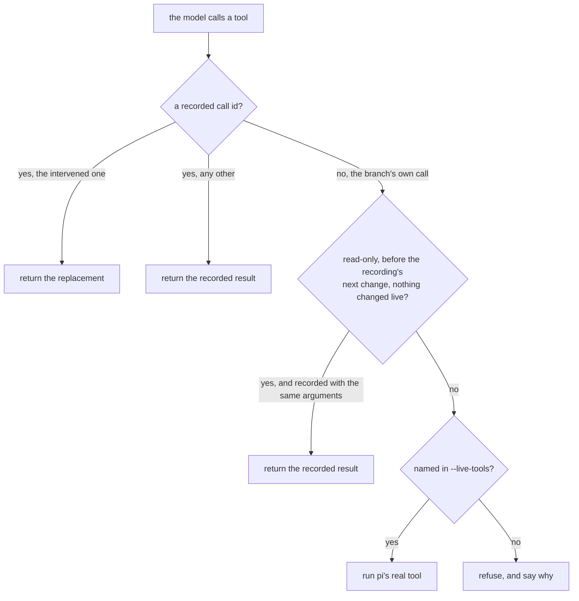
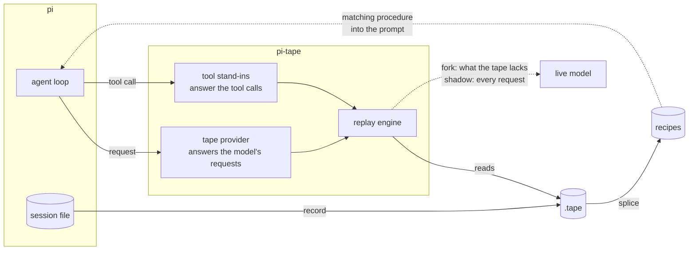
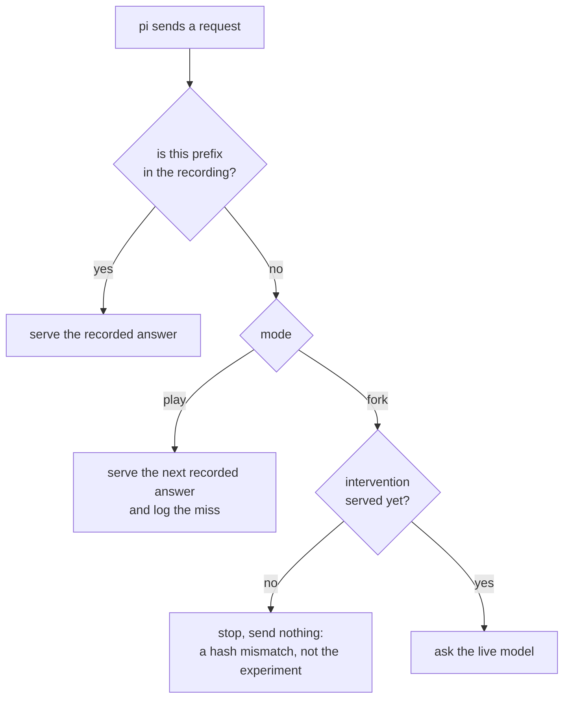

# pi-tape


**A debugger and experiment bench for [pi](https://github.com/earendil-works/pi) agent
runs. Record a run, play it back deterministically, fork it at any tool result, and
compare, step by step, what a new model — or a change to what the agent is told —
would do instead.**

An agent run is not reproducible. There is no stack trace, no breakpoint, and a failure
often happens exactly once. pi-tape records what the model and the tools actually
answered. A run can then be looked at again, changed in one place and compared —
without calling a provider for the parts that did not change, and without running the
original side effects a second time.

- **Replay a run, for free.** Recorded answers are served instead of calling a
  provider, and recorded tool results instead of running the tools. Nothing leaves the
  machine; nothing is deployed, written or deleted a second time.
- **Ask "what if the tool had said something else?"** Replace one tool result and let
  the model continue live from there. Everything before the change comes from the
  recording, so only the new branch costs tokens. That turns a guess about a cause into
  a test of it.
- **Compare a change step by step.** A new model, or an edit to `AGENTS.md`, a skill or
  a prompt: replay a recorded run and ask the model at every step what it would do
  *now*. pi-tape reports which decisions changed — strict about actions, lenient about
  wording. With a real model the comparison is a tool for a person to read, not yet an
  automatic gate: a model varies on its own, and that noise was measured to be as large
  as the change.
- **Hand a run to someone else.** A tape is one self-contained file; credentials are
  redacted before it is written.
- **Recipes** *(experimental)* — procedures distilled from several runs of the same
  task. See [Recipes](#recipes-experimental) for what they do and what they have, and
  have not, been shown to do.

pi-tape works on any pi session, after the fact: a recording is derived from pi's own
session file, so every session you have already run can be recorded.

## Contents

- [Install](#install)
- [A two-minute example](#a-two-minute-example)
- [Usage](#usage) — record · inspect · replay · fork · test a change · recipes
- [What has been shown](#what-has-been-shown)
- [Where this sits](#where-this-sits)
- [How it works](#how-it-works)
- [Reference](#reference) — `/tape` command · agent tools · CLI
- [Limits](#limits)
- [Development](#development) · [Releasing](#releasing) · [Licence and citation](#licence-and-citation)

## Install

Requires Node **22.18.0+** (the first 22.x that runs TypeScript without a flag); Node 24
and 26 are tested as well.

```bash
pi install npm:@patimweb/pi-tape
```

That installs the pi extension (the `/tape` command and its tools) and the `pi-tape`
command line. To try it from a checkout without installing:

```bash
git clone https://github.com/Smotherer007/pi-tape.git && cd pi-tape
npm install && npm test
pi -e ./extensions/index.ts
```

## A two-minute example

An agent was asked which port a service listens on. It read `notes.md`, answered
`3000` — and the config says `8080`. Was the stale note the cause, or would it have
been wrong anyway?

```
/tape record wrong
/tape fork wrong.tape --model deepseek/deepseek-flash --at 1 --result The service listens on port 8080.
/model tape/deepseek-flash
Which port does the service listen on? Read notes.md and answer with the number.
# → 8080
/tape record corrected
```

`--at 1` is the first tool call of the recording (the read of `notes.md`); `--result`
takes the rest of the line, or `@file` for something longer.

The first request came from the recording. The read of `notes.md` returned the
corrected text instead of the file. Only the answer after it was asked of the model —
one request. The note was the cause.

```
pi-tape diff wrong.tape corrected.tape
# right was forked from left, so the divergence below is the experiment, not a regression
#   fork point  read turn 1
#   replaced    "The service listens on port 8080."
#   live        1 request(s) asked of a provider
```

## Usage

### Record

From inside pi, the current session:

```
/tape record [name] [--redact] [--status success|failed|unknown]
```

From the command line, any session pi has stored:

```bash
pi-tape sessions                              # newest first
pi-tape record                                # newest session -> ./<id>.tape
pi-tape record 01a10cda --name "auth refactor" --status success
pi-tape record --redact --out shareable.tape  # credentials replaced before writing
```

A recording states how the run ended. Without `--status` it is inferred, and silence is
never success: a run with no verification and no error is `unknown`.

### Inspect and compare

```bash
pi-tape inspect run.tape --timeline   # stats, context cost per tool, intervention points
pi-tape verify run.tape               # is every recorded event servable?
pi-tape diff before.tape after.tape   # where two runs diverged
```

```
╭─ tape "next big thing" sha256:825d832bed7b
│ format      pi-tape v1 (profile: normal)
│ size        145.6 KiB on disk · 140 pooled strings · 116 entries
╰─

Run
  messages    108 (4 user, 43 assistant, 60 tool results)
  tokens      3,179,678 (72,970 in / 50,196 out)
  cost        $0.1005

Context cost per tool (result characters)
  bash            28 calls  ████████████████████████ 58,357 chars (~14,589 tok)
```

### Replay

```
/tape play baseline.tape     # arm the replay
/model tape/<model>          # switch to the replay provider (the notice names it)
<send the original first prompt>
/tape status                 # progress, misses, what the recording cost
/tape stop                   # disarm; /reload restores the real tools
```

Every answer and every tool result comes from the recording. A replay keeps working
when pi compacts the conversation along the way, when the thinking level differs from
the recording, and with parallel tool calls.

### Fork: change one thing, continue live

```
/tape fork <file> --model <provider>/<model> [options]
  --at <turn|toolCallId> --result <text|@file>   answer that tool call differently
  --live-tools read,grep                         let these run for real past the change
  --max-live-tokens N                            optional cap on what the branch may spend
```

`pi-tape inspect <file> --timeline` lists the turns you can intervene on. Up to the
intervention everything is served from the recording; after it, the model is asked.

A fork is careful about what it claims:

- **Nothing runs twice.** Recorded tool calls are always served from the tape — tools
  named in `--live-tools` included — so the replayed part never repeats a side effect.
- **No stale answers.** A live call that repeats a recorded read is answered from the
  recording only while the recording still describes the branch: for read-only tools,
  before the recording's next change, and never after a live tool has changed
  something. Every tool the recording declared is a stand-in, so a branch cannot reach
  a tool (a mail, a deploy) it was not allowed.
- **No silent spending.** A request that misses the recording *before* the
  intervention cannot be the experiment — nothing has diverged yet — so it is treated as
  the bug it is, and the fork stops without sending it.

How a tool call is answered in a fork:



A tape recorded from a fork remembers what it was forked from, and `diff` reports the
divergence as the experiment rather than a regression.

### Test a change: shadow and regress

A shadow run serves the recording — the trajectory stays fixed — and asks a model the
same request at every recorded step, with whatever it is configured with *now*:

```
/tape shadow golden.tape --model <provider>/<model>
/model tape/<recorded model>
<the original first prompt>
/tape regress
```

**A model upgrade:** shadow with the new model.

**A change to what the agent knows** — `AGENTS.md`, a skill, a prompt: shadow with the
same model after the change. Here, the rule "run `bump` before a prod deploy" was
deleted from `AGENTS.md`:

```
# golden: deepseek-flash → deepseek/deepseek-flash
#   4 request(s) · 3 identical · 1 structurally different · 0 only reworded or inspected differently
#   structurally different requests:
#     turn 2
#       recorded: bash({"command":"./shipit bump billing"})
#       new:      bash({"command":"./shipit deploy billing --env prod"})
```

Nothing is executed, and the report names the step where behaviour moved. The
comparison is strict about actions and lenient about everything else: a rephrased
sentence, an unset optional parameter or a different way of looking around (`ls -la`
against `ls`) is not a different procedure. Always shadow the *unchanged* setup
too — what differs then is the model's own noise, the baseline a real regression has to
stand out from. [`bench/knowledge-regression.mjs`](bench/knowledge-regression.mjs) runs
that control, a harmless rewording and a real regression in one go.

How far that gets you, measured: with a scripted model the deleted rule is caught at the
step it matters and the control and the rewording stay quiet. With DeepSeek Flash, the
control already differed from the recording in 3 of 6 steps — the model searched with
other words, `cd`'d first, or decided to inspect the tool instead of logging in. Part of
that was the comparison being too strict (lookups, `cd` and timeouts are no longer
counted as actions); the rest is the model. So read a shadow report as a step-by-step
account of what changed, and compare it with the control before you call anything a
regression.

### Recipes (experimental)

Several recordings of the same kind of task can be spliced into a recipe: what they
share is the procedure, what varied is a parameter, and a step only some runs needed is
kept with the condition under which it appeared.

```bash
pi-tape splice api-staging.tape web-staging.tape api-prod.tape --name shipit-deploy --save
# skeleton:
#   ./shipit login --token-file .shipit-token
#   ./shipit deploy {{arg}} --env {{env}}
# seen in some runs only:
#   ./shipit bump {{arg}}   — in 1 of 3 runs, before step 3, when env=prod

pi-tape dub shipit-deploy --set arg=billing --set env=prod
# ./shipit login --token-file .shipit-token
# ./shipit deploy billing --env prod
# seen in some runs only:
#   ./shipit bump billing   — in 1 of 3 runs, before step 3, when env=prod  ← applies here
```

Recipes live as plain JSON in a project store (`.tape/recipes/`, shadowing the global
`~/.pi/agent/tape/recipes/`). When one clearly matches the task, the extension writes
its procedure into the agent's prompt. Placeholders are typed (`secret`, `path`, `env`,
`choice`, `free`), and a credential never reaches the file. Beyond that, recipes can be
linked into chains whose seams are checked, cut into reusable segments, and run as a
plan. All of it is described in [docs/RECIPES.md](docs/RECIPES.md).

Whether recipes make the next run better is an open question — see
[What has been shown](#what-has-been-shown).

## What has been shown

The unit tests never start an agent. So the claims above were checked against a real pi
with a real model (DeepSeek Flash, thinking on) by the scripts in [`bench/`](bench).
They drive pi over RPC and check results in the world — files on disk, a tool's own log
— rather than taking the model's word for it.

| Check | What it does | Result |
|---|---|---|
| [`replay-check`](bench/replay-check.mjs) | record; change the files on disk; replay, also at another thinking level; fork with an intervention | 9 of 9, in a setup with ~200 tools from other extensions |
| [`prove`](bench/prove.mjs) | a longer run with parallel tool calls and a compaction; replay compacting at the same point; fork *after* the compaction with thinking on; the debugging case above | 14 of 14 |
| [`knowledge-regression`](bench/knowledge-regression.mjs) | shadow a recorded run with unchanged, reworded and broken `AGENTS.md`; then run the broken one for real | scripted model: caught at the right step, control and rewording quiet. DeepSeek Flash: the control itself differed in 3 of 6 steps — noise as large as the signal |
| [`recipe-experiment`](bench/recipe-experiment.mjs) | recipes vs. the agent's own notes vs. nothing, on deployments the training runs never did, with a readable and a sealed tool | no saving; fewest failed calls with recipes (below) |

**The checks found what the unit tests could not.** Each of these passed every unit
test and failed against real pi:

- replay missed every request after the first, because `durationMs` and
  `thinkingLevel` — fields that describe a past turn, not the next request — were part
  of the key;
- a fixed live-token budget stopped forks after one step in a setup with many tools;
- a compaction during a replay was answered with a recorded tool call, and every answer
  after it shifted by one;
- recipe extraction learned the failed attempts of a run and dropped the step that
  worked.

**Recipes did not pay off in the measured setting.** Three training runs were recorded
with a small in-house deploy tool, the agent wrote notes after each, and pi-tape spliced
the recordings into a recipe. Then three deployments the training never did ran three
times each per condition — once with the tool readable, once with it *sealed*
(compressed, so its source does not show the procedure):

| tool | condition | success | without a failed call | requests | tokens | cost |
|---|---|---|---|---|---|---|
| readable | nothing | 9/9 | 8/9 | 5.2 | 36,700 | $0.0026 |
| readable | the agent's own notes | 9/9 | 3/9 | 4.3 | 32,400 | $0.0030 |
| readable | recipe | 9/9 | 7/9 | 6.1 | 45,900 | $0.0031 |
| sealed | nothing | 9/9 | 8/9 | 6.4 | 51,100 | $0.0037 |
| sealed | the agent's own notes | 9/9 | 2/9 | 4.9 | 40,000 | $0.0036 |
| sealed | recipe | 9/9 | 9/9 | 6.2 | 52,700 | $0.0041 |

What it says:

- **No memory made the runs cheaper.** The notes saved a request or so and caused the
  most failed calls; the recipe cost the most, mostly in looking it up.
- **The recipe runs failed least** — 9 of 9 without a single failed call on the sealed
  tool. With nine runs per cell that is a hint, not a result.
- **Exploring was never expensive.** Every condition succeeded every time, in five to
  six requests. The sealed tool did not stay sealed: the model decompressed it with
  `node -e` and read the source.

That matches the research rather than contradicting it: learned procedures pay where
finding the way is long and costly, and a capable model with a shell finds most small
procedures by itself. Recipes stay an experiment. Where they could matter — long
procedures, steps that cannot be inspected, tries that cost real time or money — has
not been measured here.

Every check prints what it does and what it costs before it starts; most take a few
minutes and a few cents. Run them against your own pi and model:

```bash
node bench/replay-check.mjs
```

## Where this sits

**Learning procedures from agent runs** is an active line of research.
[Voyager](https://arxiv.org/abs/2305.16291) (2023) kept a growing library of skills as
code. [Agent Workflow Memory](https://arxiv.org/abs/2409.07429) (ICML 2025) induces
reusable workflows from past trajectories and reports clear gains on web benchmarks.
[Agent Skill Induction](https://arxiv.org/abs/2504.06821) (2025) keeps skills as
programs and admits one only after it has been executed and shown to work. In all
three, a language model does the abstraction — flexible, and not inspectable. pi-tape's
recipes are derived deterministically, which makes them checkable and also brittle
where a model would simply have understood. The research measures its gains on long
tasks where exploring is expensive. The measurement here was a short task, and it
found what that predicts: when a capable model finds the way in four requests, memory
has nothing to save.

**Replaying and branching runs** exists in agent frameworks that checkpoint their
state — LangGraph calls it time travel — for agents built in that framework from the
start. pi-tape works on any pi session after the fact. It replaces tool results instead
of re-running them, and it can change exactly one tool result and let the model take it
from there.

**The direction this points to** is less either half than the combination: recorded runs
as fixtures for agent knowledge. The research admits a skill after executing it again;
pi-tape can replay a change to a skill, a note or a model against recorded runs without
executing anything, and show the step where behaviour moved. The mechanism works. With
a real model, telling a moved step from the model's own variability is the unsolved
part — see [the measurement](#test-a-change-shadow-and-regress).

## How it works

pi-tape sits between pi's agent loop and everything the loop would otherwise reach. While
a tape is armed, the model's requests go to a provider that pi-tape registers, and the
tool calls go to stand-ins in place of the real tools. Both ask the replay engine, which
answers from the recording — and, in a fork or a shadow run, hands what the recording
cannot answer to a live model.



**A request is a function of its prefix.** pi-tape hashes what a provider is actually
sent — the messages, with the model and thinking level available as context — and
leaves out what only describes how an earlier turn came about: timestamps, usage,
durations, the provider that wrote it. Recorded answers are indexed by that hash and
served instead of calling a provider. Tool results are served by tool call id, so a
replay never runs a tool.

**How a request is answered.** A plain replay that misses falls back to the next
recorded answer, so it keeps going with an imperfect key — and logs the miss;
`/tape status` shows every one. A fork switches that fallback off: a new context gets a
new answer, not an old one.



**Compaction.** A request after a recorded compaction is indexed twice: by the full
history, and by what the model actually saw (the summary plus the kept messages). So
it matches whether or not the replay compacts. When pi compacts during a replay,
pi-tape answers with the recorded summary if the recording compacted at that point, and
skips the compaction otherwise. Past a fork's divergence the branch is its own run, and
a live model summarises it.

**The `.tape` file** is gzipped JSON with a string pool that stores each long string
once — about 73 % smaller than pi's session file (84 % at the `minimal` profile). It
contains the tool declarations as well as the results, so a replay needs neither your
settings nor your MCP servers nor your tool versions. Specification:
[docs/FORMAT.md](docs/FORMAT.md).

## Reference

### `/tape` — the command

| | |
|---|---|
| `/tape record [name] [--redact] [--status s]` | write this session to a `.tape` file |
| `/tape play <file>` | arm a deterministic replay |
| `/tape fork <file> --model <p>/<m> [--at … --result …] [--live-tools a,b] [--max-live-tokens N]` | replay, then continue live where the recording ends or is changed |
| `/tape shadow <file> --model <p>/<m>` | replay, and ask that model the same requests |
| `/tape regress` | what the shadow model would have done differently |
| `/tape status` | progress, misses, compactions served, what a fork or shadow spent |
| `/tape stop` | disarm (then `/reload` to restore the real tools) |
| `/tape library` · `/tape index` | the recipe store, and its graph index |

### Tools for the agent

All read-only: the agent still edits and runs things with its own tools.

| Tool | Answers |
|---|---|
| `tape_search` | do I already know how to do this? — local, offline, a few hundred tokens |
| `tape_show` | what exactly is the procedure, with its parameters and conditional steps? |
| `tape_dub` | what would it look like with these values? |
| `tape_plan` | what would running it take on this machine? — runs nothing |
| `tape_check` | is this recipe still true? |
| `tape_splice` · `tape_segment` | learn a recipe from tapes · cut one into reusable parts |

Before each run, a bounded block (about 1800 characters) tells the agent what the
recipe store holds — or, when one recipe clearly matches the task, gives it that
procedure directly. During a replay it stays silent, so a replayed run follows its
recording.

### `pi-tape` — the command line

| Command | |
|---|---|
| `sessions` | pi's sessions, newest first |
| `record [session]` | session → `.tape` (`--name`, `--status`, `--redact`, `--profile`, `--out`) |
| `inspect <tape>` | stats, context cost per tool, intervention points (`--timeline`) |
| `verify <tape>` | is every recorded event servable? |
| `diff <a> <b>` | where two runs diverged; a fork is reported as one |
| `splice <tape…>` | tapes → recipe (`--name`, `--save`, `--scope`) |
| `library` · `show <name>` | the recipe store · one recipe |
| `dub <name> --set k=v` | concrete steps for these values |
| `search <query>` | recipes for a task, within a token budget |
| `link` · `segment` · `run` · `check` · `index` · `rules` | composition, segments, execution, freshness, graph, rule packs — see [docs/RECIPES.md](docs/RECIPES.md) |
| `extension` | the path for `pi -e` |

`pi-tape help` lists every flag.

## Limits

A debugger that lies is worse than none, so:

- **Tool overrides last for the process.** pi cannot unregister a tool, so leaving a
  replay needs `/reload`. `/tape stop` makes the overrides refuse to run rather than
  pretend.
- **Replayed answers report zero cost.** Token counts are kept so the shape of the run
  stays visible; the money is zeroed so session totals stay honest.
- **Live tools run in today's directory.** What `--live-tools` lets through sees the
  folder as it is now, not as it was when the recording was made. A live branch of an
  old recording is not a faithful counterfactual. Only pi's built-in tools can be run
  this way; another tool named there is left alone, and its recorded calls run again.
- **Shadow comparisons carry the model's own noise.** A model does not answer the same
  request the same way twice; measured with DeepSeek Flash, an unchanged setup already
  differed in half of the steps. Compare every report with a control, and do not use a
  single shadow run as an automatic pass/fail gate.
- **Checked against one provider.** The `bench/` checks ran with DeepSeek Flash.
  Providers that sign their reasoning (Anthropic) are the open case for a fork, because
  replayed turns are sent back to them; `bench/prove.mjs` checks it when such a model is
  configured.
- **Recipes are an experiment.** Extraction is heuristic — a shell command is a string,
  not an AST. A recipe has no conditionals; a step only some runs needed carries the
  pattern that separated them (`when env=prod`), which with three recordings can be a
  coincidence. For a deterministic procedure, a script is exact and reviewable; a recipe
  is not a replacement for one.
- **Redaction is a layer, not a guarantee.** It catches credentials by shape and by
  context, not one written as plain prose. Read a tape before you share it.
- **`pi-tape run` executes recorded command lines.** It plans by default, quotes the
  values it binds, refuses a short list of destructive commands and stops at the first
  failure — a floor, not a sandbox. Read the plan before `--yes`.
- **Not implemented:** forking from the UI, replaying image payloads.

## Development

```bash
npm test                  # 213 tests, node:test, no agent started
npm run typecheck         # a separate gate: code has run green while carrying type errors
npm run build             # dist/, only needed to publish
node bench/prove.mjs      # against a real pi and model; reports in .tape/check/
```

```
src/hash.ts             what is part of a request, and what is not
src/replay.ts           the replay engine — pure logic, no pi
src/record.ts           session → tape, profiles, redaction
src/tape.ts             the .tape format
src/diff.ts             divergence between two recordings
src/regress.ts          two answers compared: actions strict, wording lenient
src/recipe-*.ts         extraction, alignment, query, store       ← heuristic
src/normalize.ts        command lines → shapes and templates      ← heuristic
src/contract.ts         what a step needs and delivers; linking
src/run.ts              bind, probe, execute, verify
src/cli.ts              the command line
extensions/             the pi extension
test/                   unit tests; real-session.json is a capture from real pi
bench/                  checks against a real pi and model (not shipped)
```

The package has **no runtime dependencies**. The extension declares its tool schemas
with `typebox` and uses pi's own tool implementations for `--live-tools`. pi supplies
both to extensions at runtime, so `typebox` is a `"*"` peer dependency: a second copy
could bypass pi's extension module mapping. Nothing in `src/` imports pi, so all of it
is testable without starting an agent.

## Releasing

Commit messages are the release mechanism. `release.yml` hands every push to `main` to
[semantic-release](release.config.cjs). It derives the version from the commits —
`fix:` a patch, `feat:` a minor, `feat!:` or `BREAKING CHANGE:` a major,
`docs:`/`chore:`/`test:` nothing — and publishes to npm with provenance, writes the
changelog and opens the GitHub release. `ci.yml` runs the tests on Node 22.18 (the
declared floor), 24 and 26, plus the type check.

The one secret it needs is `NPM_TOKEN`, an npm automation token allowed to publish
`@patimweb/*` (Settings → Secrets and variables → Actions). A new version can take a few
minutes to show up in `npm view`; that is the registry's cache, not a failed publish.

The tarball is an allowlist — `dist/`, the sources, the extension, the docs, the
licence, the citation file and the screenshot — and installs nothing of its own.

## Licence and citation

Apache License 2.0 — see [LICENSE](LICENSE) and [NOTICE](NOTICE). A redistribution or
a derivative keeps both files and states what it changed.

If you build on the ideas here, please say what you built on. A machine-readable
[CITATION.cff](CITATION.cff) is in the repository, and GitHub renders a "Cite this
repository" button from it.

The recipe index follows the design of
[pi-mindplace](https://github.com/Smotherer007/pi-mindplace) by the same author;
[docs/ATTRIBUTION.md](docs/ATTRIBUTION.md) says exactly what was borrowed.

## The name

A tape records a performance. This one records a run — the same decisions, the same
tool calls, the same output — that you can play back, hand to someone else, or splice
with others into a master from which a new variant is dubbed. The vocabulary follows the
metaphor where it clarifies (`record`, `play`, `splice`, `dub`) and stays plain where it
would not (`inspect`, `diff`, `search`, `recipe`, `step`).
